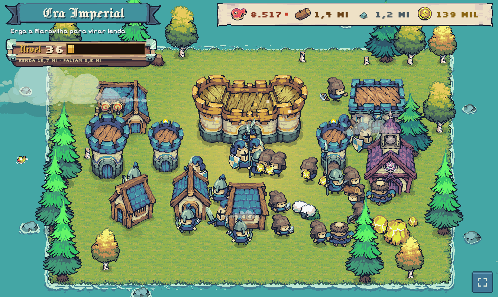
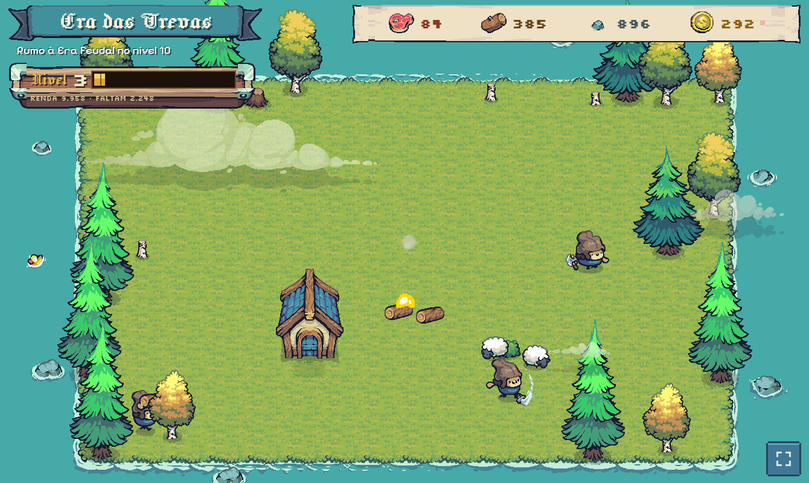
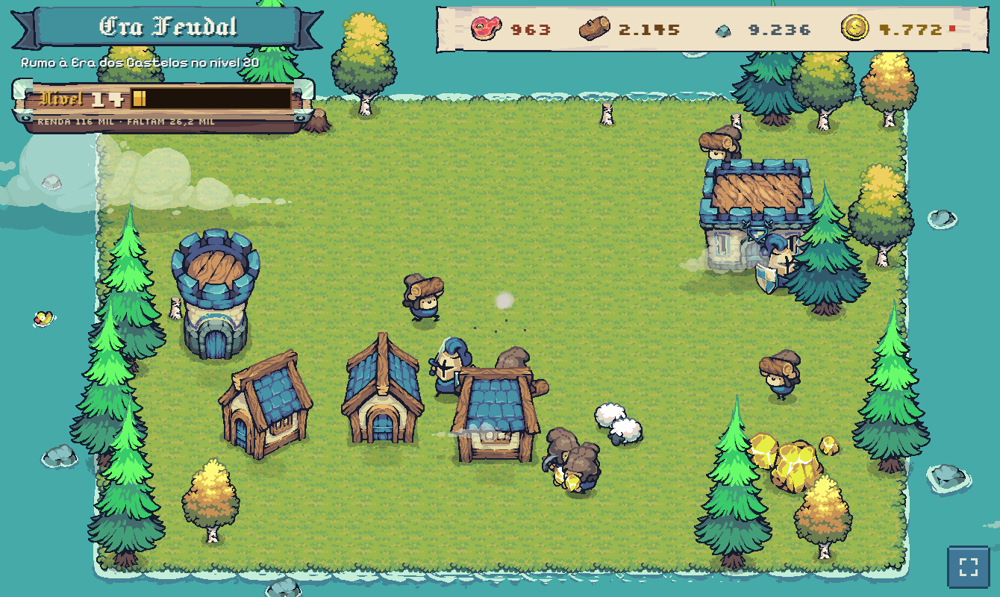
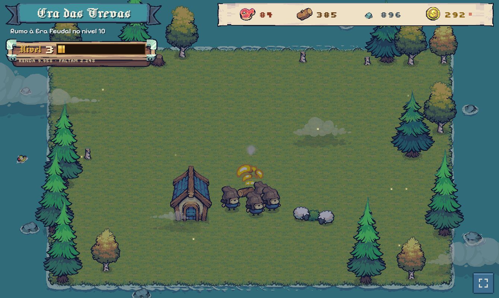
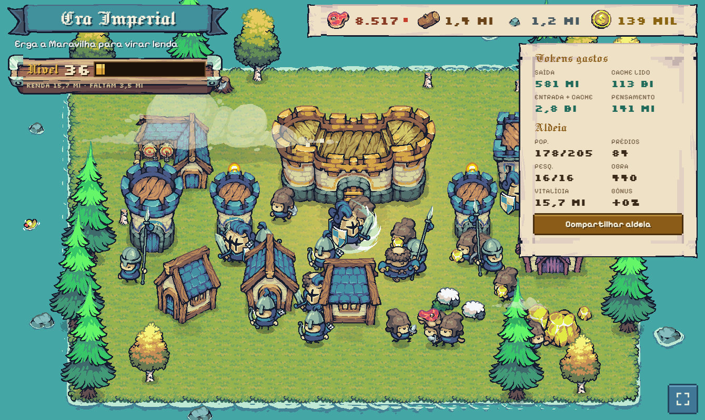

# Age of Tokens

**Uma aldeia estilo Age of Empires que evolui sozinha conforme você usa o Claude.**

Cada resposta do Claude Code vira comida, madeira, pedra e ouro. Cada ferramenta usada vira obra. Cada sessão nova traz um imigrante. Você não toma nenhuma decisão: a aldeia constrói, treina, pesquisa e avança de era por conta própria, enquanto você trabalha. Deixe aberta num tablet ao lado do computador e veja o seu uso de tokens virar uma cidade.



## Galeria

| Primeira casa (nível 3) | Era Feudal (nível 14) |
|---|---|
|  |  |

| De noite, quando você para de usar | Detalhes: tokens crus e totais |
|---|---|
|  |  |

*Os prints foram gerados com uso fictício (transcrições sintéticas), não com dados reais de ninguém.*

## A ideia

- **Zero decisões.** É um jogo para ser olhado, não jogado. O decisor automático escolhe o que construir e pesquisar.
- **Alimentado por tokens reais.** O jogo lê as transcrições do Claude Code em `~/.claude` e converte o uso em recursos.
- **Comparável.** A curva de níveis é fixa e igual para todos (nível 1 a 40 em 4 eras), então dá para dizer "olha onde já está minha aldeia" e comparar com amigos, mesmo sem nada online.
- **Sem punição.** Se você para de usar, a aldeia só dorme (a tela escurece e aparecem vaga-lumes). Nada se perde.
- **Feito para tablet deitado** (1340×800), mas funciona em qualquer tela: o palco é escalado.

## Como os tokens viram aldeia

| Uso do Claude | Vira |
|---|---|
| Tokens de **saída** (1 a cada 100) | Comida, para formar população |
| **Cache lido** (1 a cada 20.000) | Madeira |
| **Entrada + criação de cache** (1 a cada 2.000) | Pedra |
| Tokens de **pensamento** (1 a cada 50) | Ouro, para pesquisa |
| Cada **ferramenta** usada | Um ponto de obra para construir |
| **Sessão nova** | Um imigrante |
| **Subagente** | Um explorador que volta com um pequeno saque |

O cache lido é cerca de 200 vezes maior que a saída, por isso pesa pouco. Modelos têm multiplicador (Opus ×1,5, Sonnet ×1, Haiku ×0,5). Todos os números e o porquê de cada um estão em [`docs/REGRAS.md`](docs/REGRAS.md).

### Progressão

A aldeia sobe de nível só pela renda acumulada, numa curva geométrica fixa (cada nível custa 25% mais que o anterior). Quatro eras (Trevas, Feudal, dos Castelos e Imperial), 11 estágios visuais: do acampamento com uma fogueira até a Maravilha, passando por casas, torres, quartel, castelo, mosteiro e catedral.

**Lenda (prestígio).** Ao erguer a Maravilha e chegar ao nível 40, a aldeia **vira lenda** sozinha: nasce outra do zero, em outro bioma (são 5), com **+10% de produção permanente** por lenda. Para comparar jogadores valem as lendas, o nível da aldeia atual e a renda vitalícia (a soma de todas as aldeias).

## Instalação

Precisa de [Node.js](https://nodejs.org) 20 ou mais novo (desenvolvido no Node 24) e do Claude Code já usado nesta máquina. **Não há dependências para instalar** (nem `npm install`).

**1. Baixe o projeto**

```bash
git clone https://github.com/SEU-USUARIO/age-of-tokens.git
cd age-of-tokens
```

**2. Baixe a arte (obrigatório)**

Os sprites são o pacote gratuito **Tiny Swords**, de Pixel Frog, cuja licença **proíbe redistribuir os arquivos**, então eles não vêm neste repositório. São 3,3 MB e levam um minuto:

1. Abra <https://pixelfrog-assets.itch.io/tiny-swords>, clique em **Download** e escolha "No thanks, just take me to the downloads" (valor zero).
2. Baixe `Tiny Swords (Free Pack).zip`.
3. Extraia em `web/assets/tiny-swords/`, de modo que exista `web/assets/tiny-swords/Tiny Swords (Free Pack)/Units/Blue Units/Pawn/...`.

Sem isso a página mostra só as instruções. Detalhes em [`docs/ASSETS.md`](docs/ASSETS.md).

**3. Rode**

```bash
npm start
```

O terminal mostra os endereços:

```
  neste computador:       http://localhost:4100
  no tablet (mesma rede): http://192.168.1.6:4100   [Ethernet]
```

Abra o primeiro no computador e, no tablet conectado ao mesmo Wi-Fi, o segundo.

> O jogo **começa do zero**: só conta o que você usar a partir de agora. Para contar todo o histórico que já existe em `~/.claude`, inicie com `npm start -- --history`.

## Como usar

- **Deixe aberto** (no tablet ou numa aba) e trabalhe normalmente com o Claude Code. A aldeia cresce sozinha.
- **Tela cheia:** botão no canto inferior direito.
- **Detalhes:** toque na barra de recursos para ver tokens crus, população, prédios, pesquisas e bônus de lenda.
- **Compartilhar:** o botão **Compartilhar aldeia**, nos detalhes, gera uma imagem PNG com a era, o nível e os tokens, para mostrar para os amigos.
- **Instalar como app (PWA):** o navegador só permite instalar e usar offline em contexto seguro (`localhost` ou HTTPS). Em `http://192.168.x.x` o jogo funciona normalmente, mas sem instalação. Para o PWA completo no tablet, sirva por HTTPS (um túnel como Tailscale Serve ou Cloudflare Tunnel) ou, no Chrome do tablet, habilite `chrome://flags/#unsafely-treat-insecure-origin-as-secure` para o endereço do seu computador.

### Configuração

Variáveis de ambiente (no Windows PowerShell: `$env:PORT=4200; npm start`; no Linux/macOS: `PORT=4200 npm start`):

| Variável | Padrão | O que faz |
|---|---|---|
| `PORT` | `4100` | Porta do servidor |
| `HOST` | todas as interfaces | Use `127.0.0.1` para fechar o acesso ao tablet |
| `STEP_MS` | `3000` | Ritmo da aldeia (uma ação a cada N ms) |
| `CLAUDE_HOME` | `~/.claude` | Onde ficam as transcrições do Claude Code |
| `SAVE_FILE` | `data/save.json` | Arquivo do progresso |

## Privacidade e segurança

- O jogo **só lê** `~/.claude` (transcrições do Claude Code) para contar tokens, sessões e ferramentas. **Nunca escreve lá**, e não envia nada para a internet.
- Ele **não guarda o conteúdo** das conversas: só os totais de tokens.
- O servidor escuta em toda a rede local de propósito, para o tablet conectar. A API é só leitura (apenas GET), mas **qualquer aparelho na sua rede vê os seus totais de tokens**. Para fechar: `HOST=127.0.0.1 npm start`. Se o tablet não conectar, libere a porta 4100 no firewall.

## Seu progresso está seguro

O save fica em `data/save.json`, com checksum, gravação atômica e travas contra dois servidores ao mesmo tempo. Ao lado ficam `save.json.prev` (o save anterior) e `backups/` (1 por hora nas últimas 24 h e 1 por dia na última semana). Se o arquivo principal estragar, o jogo se recupera sozinho do `.prev` ou do backup mais novo e avisa no terminal. Para guardar uma cópia fora do computador, copie a pasta `data/backups/` para a nuvem. Se uma versão nova mudar o formato, o save é migrado e nunca descartado.

Se aparecer "já existe um servidor rodando", o jogo já está aberto em outra janela: use essa, ou feche-a antes.

## Como funciona por dentro

JavaScript puro (ESM), **sem dependências e sem build**.

| Pasta | O que faz |
|---|---|
| `ingest/` | Lê `~/.claude/projects` de forma incremental (posição persistida, sem contar nada duas vezes) e emite eventos de tokens, sessões e ferramentas |
| `sim/` | Motor puro, sem I/O: tokens viram recursos e o decisor automático constrói, pesquisa e avança de era |
| `server/` | Junta tudo, salva e serve HTTP e SSE (só GET) |
| `web/` | A tela: ilha vista de cima em canvas 2D, que evolui em 11 estágios, mais o HUD, o PWA e o cartão de compartilhar |
| `docs/` | Conceito, regras, decisões de projeto e progresso |

Para entender o raciocínio por trás de cada escolha, leia [`docs/CONCEITO.md`](docs/CONCEITO.md), [`docs/REGRAS.md`](docs/REGRAS.md) e [`docs/DECISOES.md`](docs/DECISOES.md).

### Testes

```bash
npm test
```

Cobrem a ingestão, o motor (incluindo uma jornada completa até a lenda), o servidor, o save, o layout dos estágios, a navegação dos aldeões e a lógica do service worker. A renderização em canvas e o registro real do service worker não são testáveis no Node e foram conferidos à mão.

## Limitações conhecidas

- O modo offline/PWA exige HTTPS (veja acima).
- Ainda não há ranking nem "hall da fama" das aldeias lendárias; a comparação é por conversa e pelo cartão de compartilhar.
- O bônus de lenda não tem teto: depois de várias lendas o jogo acelera sem limite.
- Em caso de queda do computador, perdem-se no máximo uns 5 segundos de progresso.

## Créditos

- Arte: [Tiny Swords](https://pixelfrog-assets.itch.io/tiny-swords) por Pixel Frog (não incluída no repositório; veja a instalação).
- Fontes: Jacquard 12, Pixelify Sans e Silkscreen (SIL Open Font License 1.1), incluídas em `web/fonts/` com as licenças.
- Ícones do app: próprios, gerados por `scripts/make-icons.mjs`.
- Claude e Claude Code são produtos da Anthropic. Este projeto é independente e não é afiliado nem endossado por ela.
